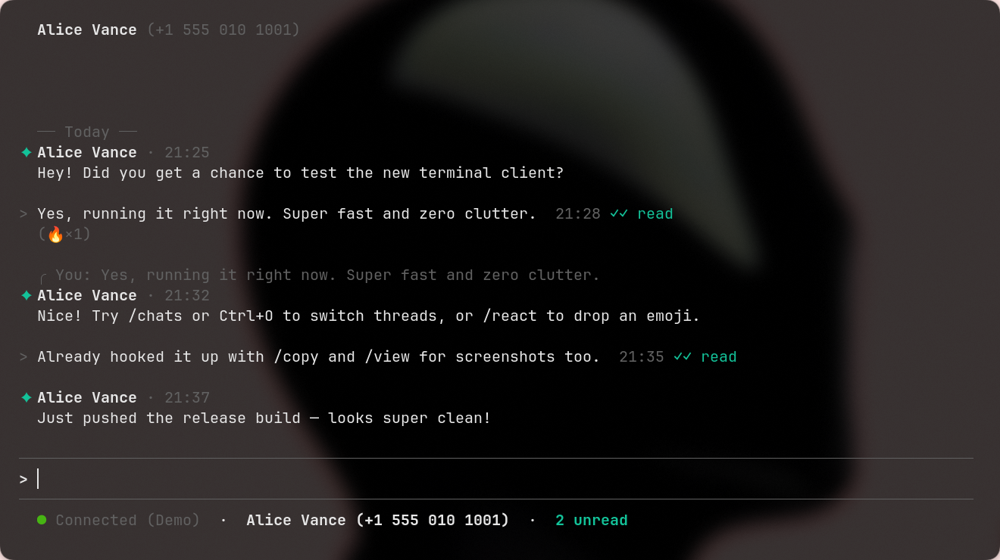
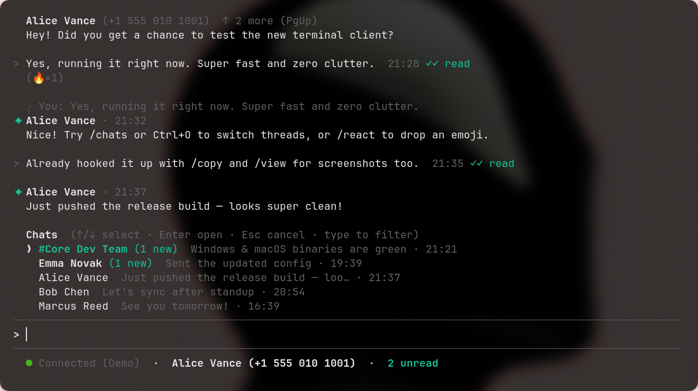

# signal-term

A minimalist, fast Signal client for the terminal built in Go. Designed for distraction-free messaging right inside your terminal with full support for DMs, groups, replies, reactions, message editing, and attachments.

## Preview

**Active Chat (Minimalist TUI):**



**Chat Selector (`/chats` or `Ctrl+O`):**



## Features

- **Minimalist Full-Screen Terminal UI:** Clean, distraction-free layout with live typing indicators and read/delivery receipts.
- **Direct Messages & Groups:** Browse, search, and switch conversations instantly with `/chats` (`Ctrl+O`) or `/open <name>`.
- **Rich Interactions:** Quote-reply (`/reply`), react with custom or quick emoji (`/react`), and edit sent messages (`/edit`).
- **Seamless Attachments & Clipboard:** Paste images or file paths directly with `Ctrl+V` (auto-converts to `/attach`), copy received images to clipboard (`/copy`), or open attachments (`/view`).
- **Search & Unread Filtering:** Search inside any chat (`/find <query>`) or jump straight to unread threads (`/unread`).
- **Offline Demo Mode:** Run `signal --demo` to preview the interface with sample data without linking an account.
- **Cross-Platform (~3 MB Binary):** Runs natively on Linux, Windows, and macOS.

---

## Prerequisites

`signal-term` uses [`signal-cli`](https://github.com/AsamK/signal-cli) as its local Signal protocol backend:

- **macOS:** `brew install signal-cli`
- **Arch Linux:** `pacman -S signal-cli` (or AUR)
- **Ubuntu / Debian / Windows:** Download the latest `signal-cli` release from [AsamK/signal-cli](https://github.com/AsamK/signal-cli/releases) and add it to your `PATH` (on Windows, `%LOCALAPPDATA%\signal-cli\bin\signal-cli.bat` is also detected automatically).

---

## Quick Install & Run

Install once, then run `signal` from anywhere in your terminal.

### Windows (PowerShell)

```powershell
iwr https://github.com/filipboski1313-a11y/signal-term/releases/latest/download/signal-windows-amd64.exe -OutFile "$env:LOCALAPPDATA\Microsoft\WindowsApps\signal.exe"
signal
```

### Linux (x86_64)

```bash
sudo curl -L https://github.com/filipboski1313-a11y/signal-term/releases/latest/download/signal-linux-amd64 -o /usr/local/bin/signal && sudo chmod +x /usr/local/bin/signal && signal
```

### macOS

**Apple Silicon (M1 / M2 / M3 / M4):**

```bash
sudo mkdir -p /usr/local/bin && sudo curl -L https://github.com/filipboski1313-a11y/signal-term/releases/latest/download/signal-macos-arm64 -o /usr/local/bin/signal && sudo chmod +x /usr/local/bin/signal && signal
```

**Intel Mac:**

```bash
sudo mkdir -p /usr/local/bin && sudo curl -L https://github.com/filipboski1313-a11y/signal-term/releases/latest/download/signal-macos-amd64 -o /usr/local/bin/signal && sudo chmod +x /usr/local/bin/signal && signal
```

*(If macOS blocks the binary on first run, run `sudo xattr -d com.apple.quarantine /usr/local/bin/signal` once.)*

---

## First-Time Setup

Run `signal` (or `signal link`) and scan the QR code in your terminal with the Signal app on your phone:

**Settings → Linked Devices → + (Link New Device)**

You can also try the UI immediately without linking an account:

```bash
signal --demo
```

---

## Commands & Shortcuts

| Command / Key | Description |
| :--- | :--- |
| `/chats` or `Ctrl+O` | Browse, search, and switch chats |
| `/open <name>` | Open a chat directly by name |
| `/reply` | Select a message to quote-reply |
| `/react [emoji]` | React to a message with an emoji |
| `/edit <text>` | Edit your last sent message |
| `/attach <path> [caption]` | Send an image or file |
| `/copy` | Copy the latest received image (or `/copy list`) |
| `/view` | Open a received attachment (or `/view list`) |
| `/find <query>` | Search messages in the active chat |
| `/unread` | Show chats with unread messages |
| `/refresh` | Sync contacts and groups |
| `/help` | Show commands and shortcuts |
| `/quit` or `Ctrl+C` | Exit |

---

## Build from Source

Requires Go 1.22+:

```bash
git clone https://github.com/filipboski1313-a11y/signal-term.git
cd signal-term
go build -ldflags="-s -w" -o signal .
./signal
```
